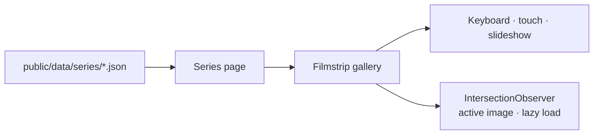

<div align="center">


<p>
  
  
  
  
</p>

<p><em>A fan archive of the wizarding world: characters, spells, wands, brooms and the four Hogwarts houses,<br>
presented as a smooth, keyboard-friendly filmstrip gallery.</em></p>

</div>


## What it is

Wizarding Realm collects the universe's characters, spells, items and houses into four series. Each one opens as a horizontal filmstrip: click an image to centre it, use the arrow keys, or let it play as a slideshow. It is built to feel the same for someone reading the books for the first time and for a long-time fan.

| | |
|---|---|
| **Filmstrip gallery** | Horizontal scrolling with click-to-centre and automatic active-image detection. |
| **Keyboard navigation** | Arrow keys, <kbd>Home</kbd> and <kbd>End</kbd>. |
| **Slideshow** | Optional auto-advance every 4.5 s that pauses on hover or focus. |
| **Touch** | Native momentum scrolling on phones. |
| **Fast** | The first three images load eagerly, the rest lazily. |
| **Series** | Characters, spells, items and houses, each from its own JSON file. |
| **SEO** | Meta tags, a sitemap and `robots.txt`. |




## Türkçe özet

**Wizarding Realm**, Harry Potter evrenine adanmış bir hayran arşivi. Karakterler, büyüler, asalar, süpürgeler ve dört Hogwarts binası dört seri halinde, yatay kayan bir film şeridi galerisiyle sunuluyor. Klavyeyle gezinme, dokunmatik kaydırma, otomatik slayt gösterisi ve hızlı yükleme var.


## Development

```sh
npm install
npm run dev      # http://localhost:8080
npm run build
```

<div align="center">
<br>
<a href="https://github.com/kutluhangil"></a>
<sub>Unofficial fan project · Harry Potter and all related names belong to their respective owners.</sub>
</div>
