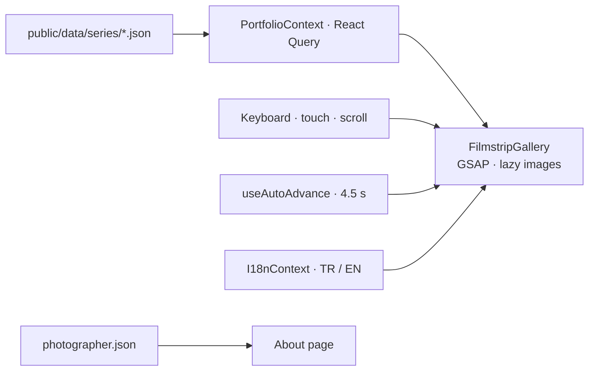

<div align="center">



<p>
  
  
  
  
</p>

<p><em>A fan archive of the wizarding world: characters, spells, items and the four houses,<br>
presented as a smooth filmstrip gallery you can scroll, swipe, key through or leave on slideshow.</em></p>

</div>



## The idea

Wizarding Realm borrows the layout of a photographer's portfolio and fills it with a fan's guide. Each series is a horizontal filmstrip: the frame in the middle is the one you are looking at, its caption sits under it, and the strip moves when you scroll, swipe, press an arrow key or let the slideshow run. The whole site is content-driven, so adding a series is adding a JSON file.

> **Content lives in JSON, not in components.** `public/data/series/*.json` holds each series (title, slug, description, images with localized captions), and `photographer.json` holds the About page. The React app only knows how to show them.


## Features

| | |
|---|---|
| **Filmstrip gallery** | Horizontal scrolling with click-to-centre and automatic detection of the active frame. |
| **Keyboard** | <kbd>←</kbd> <kbd>→</kbd> to step, <kbd>Home</kbd> and <kbd>End</kbd> to jump to the ends. |
| **Slideshow** | Optional auto-advance every 4.5 seconds that pauses on hover or focus. |
| **Touch** | Native momentum scrolling on phones. |
| **Fast** | The first frames load eagerly, the rest lazily through an IntersectionObserver, with skeletons while they arrive. |
| **Four series** | Characters (8 frames), spells (6), items (6) and houses (4), each from its own JSON file. |
| **About page** | The archive's story, focus and contact, from `photographer.json`. |
| **TR / EN** | Every caption and page in Turkish and English. |
| **SEO** | Per-page meta tags, a sitemap and `robots.txt`. |


## How it fits together



| Route | Page |
|---|---|
| `/` | Home with the featured series |
| `/series/:slug` | One series as a filmstrip |
| `/about` | About the archive |


## Türkçe özet

**Wizarding Realm**, büyücülük dünyasına adanmış bir hayran arşivi: karakterler, büyüler, eşyalar ve dört Hogwarts binası, akıcı bir film şeridi galerisinde. Ortadaki kare etkin olan; şerit kaydırma, dokunma, ok tuşları ya da 4,5 saniyede bir ilerleyen slayt gösterisiyle hareket ediyor. İçerik JSON dosyalarından geliyor, görseller tembel yükleniyor, arayüz Türkçe ve İngilizce.


## Development

```sh
npm install      # or bun install
npm run dev
npm run build
npm run lint
```

```
public/data/series/     characters, spells, items, houses (JSON)
public/data/            photographer.json for the About page
src/components/gallery/ FilmstripGallery, GalleryImage, GalleryControls, skeleton
src/hooks/              useGallery, useAutoAdvance, useKeyboardNavigation
src/context/            portfolio data and i18n
```

<div align="center">
<br>
<a href="https://github.com/kutluhangil"></a>
<sub>A non-commercial fan project, not affiliated with J.K. Rowling, Warner Bros. or Wizarding World · photos from Unsplash · the frames in the banner are drawn moods.</sub>
</div>
